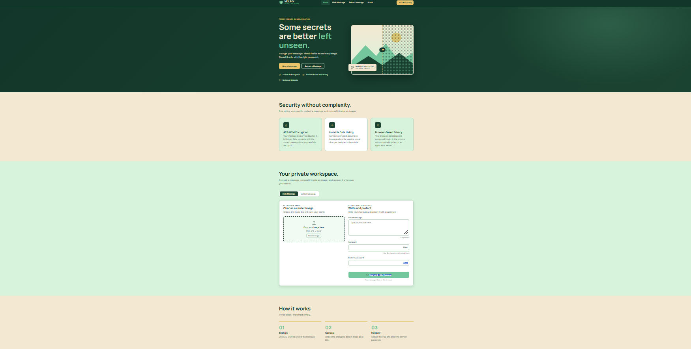

# VEILPIX – Secure Image Steganography

## About
VEILPIX is a web-based cryptography project designed to hide secret messages inside images and retrieve them when needed.

## Features
- Hide secret messages inside images
- Extract hidden messages
- Password-based message protection
- Simple and user-friendly interface
- Browser-based application

## Technologies Used
- HTML
- CSS
- JavaScript
- Web Crypto API (if implemented)

## Live Demo
https://lalithkhalap.github.io/veilpix-secure-steganography/

## How to Use
1. Open the live website.
2. Select Hide Message or Extract Message.
3. Follow the instructions displayed on the website.

## Project Purpose
This project demonstrates the concepts of image steganography and cryptography for educational purposes.
## Website Preview

## Live Demo

[Open VEILPIX Website](https://lalithkhalap.github.io/veilpix-secure-steganography/)

